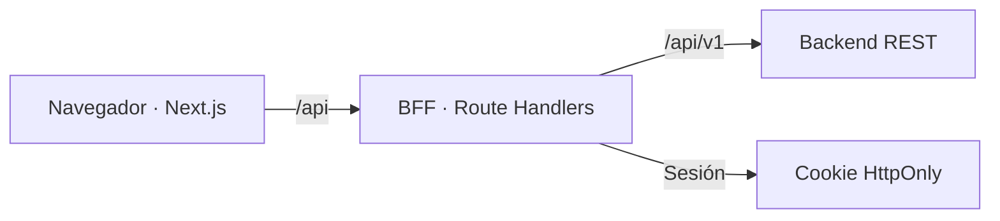

<div align="center">

# URBNVOID · Marketplace

**Una tienda, varios vendedores, una experiencia de compra.**

Frontend en Next.js para clientes, vendedores y administradores, conectado a un backend REST mediante un BFF propio.

**[Empezar](#puesta-en-marcha)** · **[Explorar módulos](#qué-incluye)** · **[Consultar las APIs](docs/integracion-backend/README.md)** · **[Ver el plan](docs/integracion-backend/plan-frontend.md)**

</div>

---

## Qué incluye

| Área | Capacidades implementadas en el frontend |
| :--- | :--- |
| **Clientes** | Catálogo y ficha de producto, carrito local, perfil, direcciones, checkout con cupones, confirmación y seguimiento de envío. |
| **Vendedores** | Selección de tienda autorizada, perfil comercial, catálogo paginado, alta y publicación de productos, imágenes por URL y gestión de sus órdenes. |
| **Administración** | Usuarios, roles, membresías, vendedores, marcas, categorías, productos, importación CSV, cupones, fulfillments y envíos. |
| **Sesión** | Registro, acceso, recuperación y cambio de contraseña; permisos por rol y JWT conservado en cookie HttpOnly. |

Las fases **F1–F5** están implementadas en el frontend. La aceptación funcional con un backend activo y stock de prueba sigue pendiente. Consulta la [auditoría y sus límites](docs/auditoria-jtn.md) antes de dar por validado un flujo extremo a extremo.

## Cómo se conecta



El navegador llama a `/api` de Next.js. El BFF adapta las respuestas del backend al contrato HTTP del frontend, adjunta el JWT desde la cookie y añade los datos de servidor necesarios para checkout. El carrito se guarda localmente con Zustand; los datos remotos se gestionan con TanStack Query. No se usa Redux.

## Puesta en marcha

**Requisitos:** Node.js compatible con Next.js 16, pnpm y acceso al backend del marketplace.

1. Instala las dependencias:

   ```bash
   pnpm install
   ```

2. Copia [`.env.template`](.env.template) a `.env.local` y ajusta los valores para tu entorno:

   ```bash
   cp .env.template .env.local
   ```

   `API_BASE_URL` debe incluir `/api/v1` **una sola vez**. El almacén `1` es solo el ejemplo del entorno de desarrollo: configura el ID real de cada entorno antes de probar compras. Estas variables se leen en el servidor; no deben llevar el prefijo `NEXT_PUBLIC_`. `.env.local` queda fuera de Git.

3. Inicia la aplicación:

   ```bash
   pnpm dev
   ```

   Abre [http://localhost:3000](http://localhost:3000).

Para crear productos desde el portal vendedor, registra primero las categorías y marcas reales del entorno en [`src/modules/shared/config/catalog-references.ts`](src/modules/shared/config/catalog-references.ts). Si no hay categorías activas configuradas, el alta queda bloqueada. Crear o importar un producto **no provisiona inventario**; una compra de prueba requiere stock en el backend.

## Comandos

| Comando | Uso |
| :--- | :--- |
| `pnpm dev` | Servidor de desarrollo. |
| `pnpm build` | Compilación de producción. |
| `pnpm start` | Inicia la compilación de producción. |
| `pnpm lint` | Analiza el código con Biome. |
| `pnpm format` | Formatea `src`, `__tests__` y la configuración de Vitest. |
| `pnpm exec tsc --noEmit` | Comprueba tipos sin emitir archivos. |
| `pnpm test` | Ejecuta las pruebas unitarias con Vitest. |

El hook de pre-commit ejecuta lint y aplica Biome a los archivos JavaScript/TypeScript preparados para el commit.

## Organización

```text
src/
├── app/                 # Rutas públicas, de acceso, administración y BFF
└── modules/
    ├── admin/           # Gestión del marketplace
    ├── auth/            # Sesión, permisos y formularios de acceso
    ├── fulfillment/     # Órdenes, fulfillments y envíos
    ├── public/          # Catálogo, carrito, cuenta y checkout
    ├── seller/          # Portal de vendedores
    └── shared/          # UI, formularios, tabla, HTTP y utilidades comunes
__tests__/               # Pruebas organizadas en paralelo a los módulos
docs/                    # Contratos, plan y auditoría
```

Los componentes de dominio se ocupan de la presentación; hooks, servicios, schemas, constantes y columnas de tabla viven en sus carpetas correspondientes. Los formularios reutilizan wrappers sobre componentes shadcn/ui y las tablas reactivas comparten una base de TanStack Table.

## Stack

**Next.js 16 · React 19 · TypeScript · Tailwind CSS 4 · shadcn/ui · Axios · TanStack Query/Table · React Hook Form · Zod · Zustand · Biome · Vitest**

## Documentación

| Documento | Para qué sirve |
| :--- | :--- |
| [Índice de integración](docs/integracion-backend/README.md) | Procedencia del backend y contratos de sus **70 operaciones HTTP**. |
| [Flujo del backend](docs/integracion-backend/flujo-backend.md) | Registro, publicación, compra multivendedor y logística. |
| [Matriz de integración](docs/integracion-backend/matriz-integracion.md) | Relación entre API, actor, pantalla y fase. |
| [Plan del frontend](docs/integracion-backend/plan-frontend.md) | Decisiones de arquitectura y fases F1–F5. |
| [Decisiones y límites](docs/integracion-backend/decisiones-limitaciones.md) | Capacidades reales y restricciones del backend. |
| [Pruebas de aceptación](docs/integracion-backend/pruebas-aceptacion.md) | Escenarios para validar la integración. |
| [Auditoría JTN-*](docs/auditoria-jtn.md) | Revisión estructural, verificaciones y trabajo pendiente. |

Los contratos describen el backend recibido en el ZIP y conservan su procedencia. Sus apartados de «estado actual del frontend» son una fotografía de la etapa documental inicial; usa el plan y la auditoría para el avance posterior.

## Estado de validación

Biome, TypeScript y la suite unitaria existente pasan (**18 pruebas**). La compilación de producción no pudo completarse en el entorno de auditoría porque Next.js no logró descargar las fuentes de Google. Tampoco se ejecutaron pruebas HTTP contra un backend activo.

No se presentan pagos, Google OAuth, estadísticas ni notificaciones en tiempo real como funciones disponibles. El estado comercial de la orden, el fulfillment por vendedor y el envío global son procesos separados en el backend.
