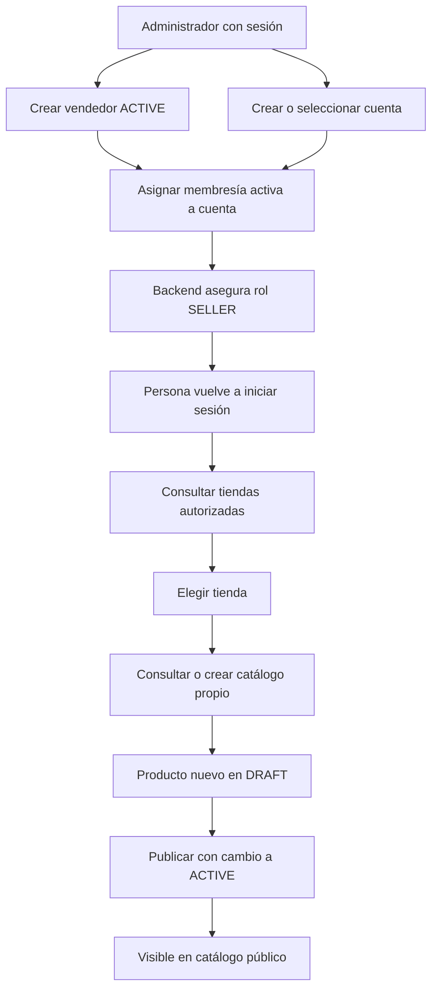
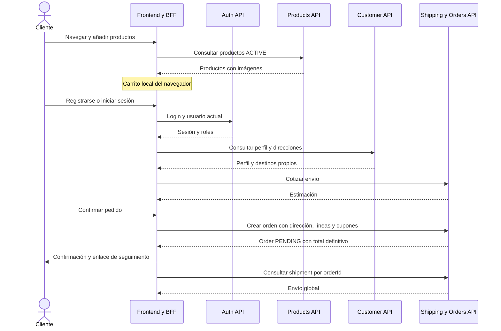
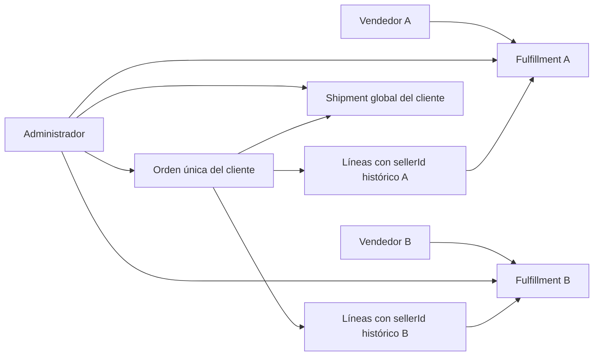

# Flujo real del marketplace

[Índice](README.md) · [Contratos operativos](contratos/ordenes-envios-fulfillment.md)

## Actores y fronteras

| Actor | Identidad y capacidad |
|---|---|
| Visitante | Catálogo activo, ficha e imágenes públicas |
| CUSTOMER | Su perfil/direcciones, cotización, checkout y envío de una orden propia |
| SELLER | Tiendas con membresía activa; catálogo propio y porciones propias de órdenes |
| ADMIN | Usuarios/roles/membresías, maestros, productos, cupones, operación global |

Una persona puede acumular roles. La empresa vendedora es una entidad Seller distinta de la persona UserAccount. SellerMembership une userId con sellerId y guarda active/owner. Un rol SELLER sin membresía activa no abre una tienda.

El administrador no necesita membresía para intervenir por rutas administrativas; no obtiene automáticamente el permiso SELLER para los endpoints del portal. Los roles personalizados no habilitan permisos funcionales nuevos.

## Acceso y alta del vendedor

Crear producto no implica inventario disponible. El aprovisionamiento de stock ocurre fuera de las APIs expuestas; ACTIVE significa publicación, no cantidad garantizada. Las marcas/categorías del formulario vendedor vienen de referencias reales configuradas, no de llamadas administrativas sin autorización.

Todos los miembros activos pueden operar el catálogo; owner identifica al propietario sin otorgarle acciones exclusivas. Desactivar membresía revoca contexto; desactivar tienda bloquea escrituras de catálogo, conservando lecturas. El caso de fulfillment comprueba membresía pero no el estado comercial de la tienda.

Fuentes: IdentityAdministrationResource, ManageSellerMembershipsUseCase, SellerCatalogResource, SellerCatalogUseCase, CreateProductUseCase y ChangeProductStatusUseCase; detalles y paths completos en sus contratos.

## De visitante a cliente que crea un pedido

El registro crea una cuenta CUSTOMER, sin token. Después del login el BFF conservará el JWT en cookie HttpOnly; el navegador consultará el usuario actual. El perfil de cliente no contiene roles y no reemplaza el modelo de autenticación.

La primera dirección queda predeterminada. Elegir otra, editar o eliminar puede cambiar qué dirección es predeterminada; volver a consultar la libreta. Dirección de otra persona no es elegible.

La cotización usa subtotal indicado por el frontend. Solo al crear orden el backend vuelve a consultar producto/precio/estado/stock y establece importes oficiales. No hay validación separada de cupón ni pago con pasarela. El texto de éxito será “Pedido creado”, sin afirmar que está pagado.

## Dentro de la transacción de checkout

1. Validar userId contra sub del JWT, cliente y líneas no vacías.
2. Para cada línea, exigir producto ACTIVE y capturar sellerId, SKU, nombre y precio.
3. Calcular subtotal y aplicar cupones válidos en el orden recibido.
4. Validar dirección propia y recalcular envío a partir del subtotal anterior a descuentos.
5. Reservar cada cantidad en la fila de inventario producto+almacén, con bloqueo pesimista. Falta de stock produce conflicto; inventario inexistente es validación.
6. Persistir una sola Order PENDING, sus líneas y un shipment global PENDING.
7. Agrupar las líneas por vendedor y crear un fulfillment PENDING por sellerId distinto.
8. Registrar usos de cupones y eventos Outbox en la misma transacción.
9. Tras commit, intentar publicar eventos. Un fallo posterior de mensajería no revierte la compra confirmada.

No quedan reservas/orden parciales si falla la transacción. Esto no convierte el POST en idempotente: dos solicitudes exitosas crean dos compras. Fuente principal: `src/main/java/org/ricm/order/application/CheckoutUseCase.java`.

El checkout actual fija PEN. Los impuestos internos son cero; el record Order no expone taxTotal ni sus líneas. Nunca reconstruir el total final como sustituto del retornado.

## Una orden, varias preparaciones y un envío

El sellerId de la línea es un snapshot comercial. Reasignar un producto posteriormente no mueve la preparación histórica a otro vendedor. La lista del vendedor contiene exclusivamente sus propias líneas; no completar esa respuesta con información de otra tienda.

Las tres capas se operan separadamente:

| Capa | Cómo cambia | Lo que no hace automáticamente |
|---|---|---|
| Order.status | ADMIN completa PENDING/PAID → FULFILLED | No actualiza entrega ni captura pagos |
| SellerFulfillment.status | SELLER miembro o ADMIN actualiza su porción | No actualiza shipment ni orden |
| Shipment.status | ADMIN actualiza entrega global | No completa orden ni sincroniza todas las porciones |

En fulfillment y shipment: PENDING→READY_TO_SHIP→SHIPPED→DELIVERED, cancelación desde los dos primeros estados. SHIPPED/DELIVERED necesitan carrier y tracking. Repetir estado permite actualizar metadatos.

Cancelar logística no cancela compra, reembolsa ni libera reservas. Completar una orden evalúa productos sin disponibilidad y los marca INACTIVE; no descuenta cantidad física ni implementa un ciclo separado de liberación de stock.

Fuentes: UpdateSellerFulfillmentUseCase, UpdateShipmentUseCase, CompleteOrderUseCase, PanacheOrderRepository y PanacheInventoryReservationAdapter.

## Refresco y continuidad de la interfaz

El backend publica eventos en Azure Service Bus con entrega al menos una vez. No expone WebSocket/SSE ni un canal de notificaciones para el navegador. Usar respuesta de mutación, invalidación de consultas y botón de actualizar. No conectar UI directamente a MySQL, Redis o Service Bus.

Conservar el orderId recibido para consultar envío; no hay historial ni detalle de orden del cliente. La confirmación podrá conservar el Order retornado en sesión del navegador, pero eso no es historial remoto ni evidencia de datos actualizados. Los límites y recuperación de contexto se detallan en el [plan](plan-frontend.md).

